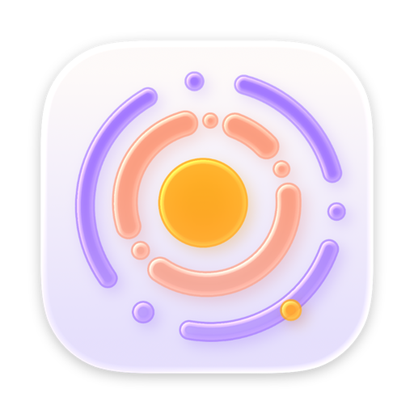
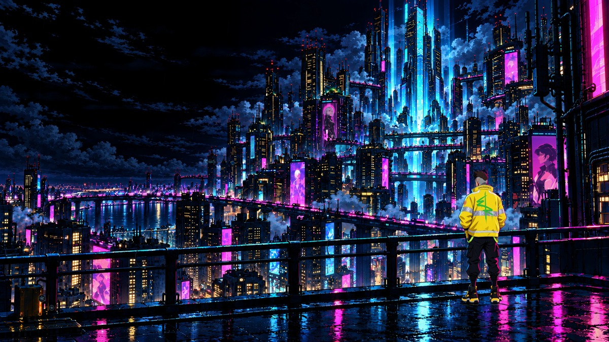
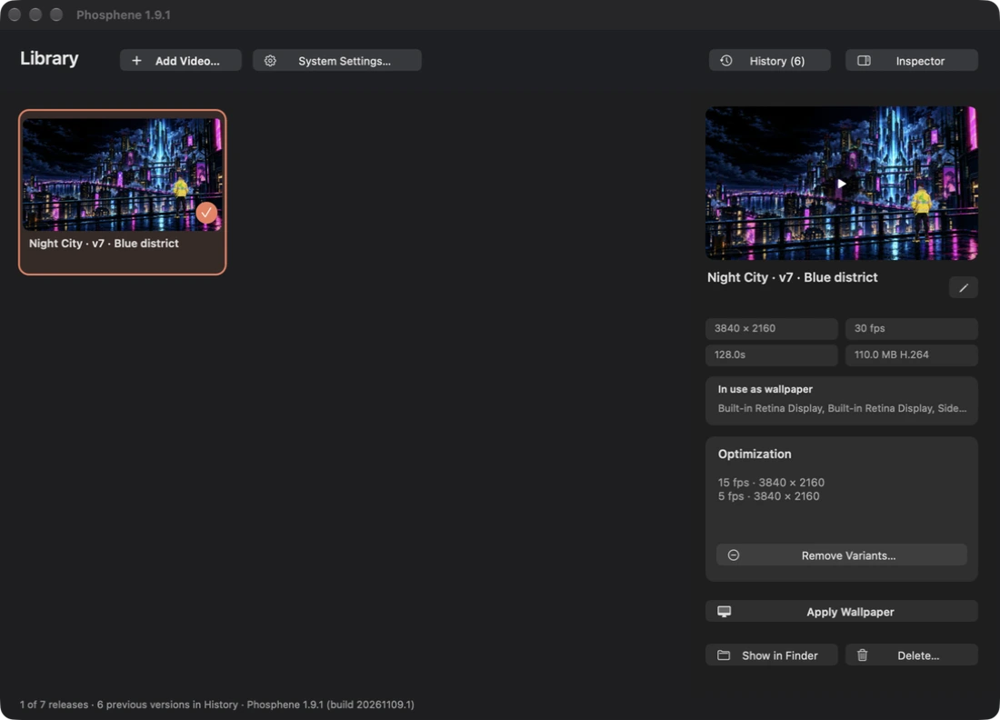
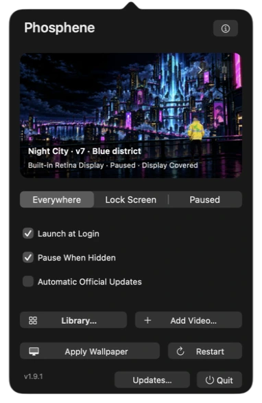
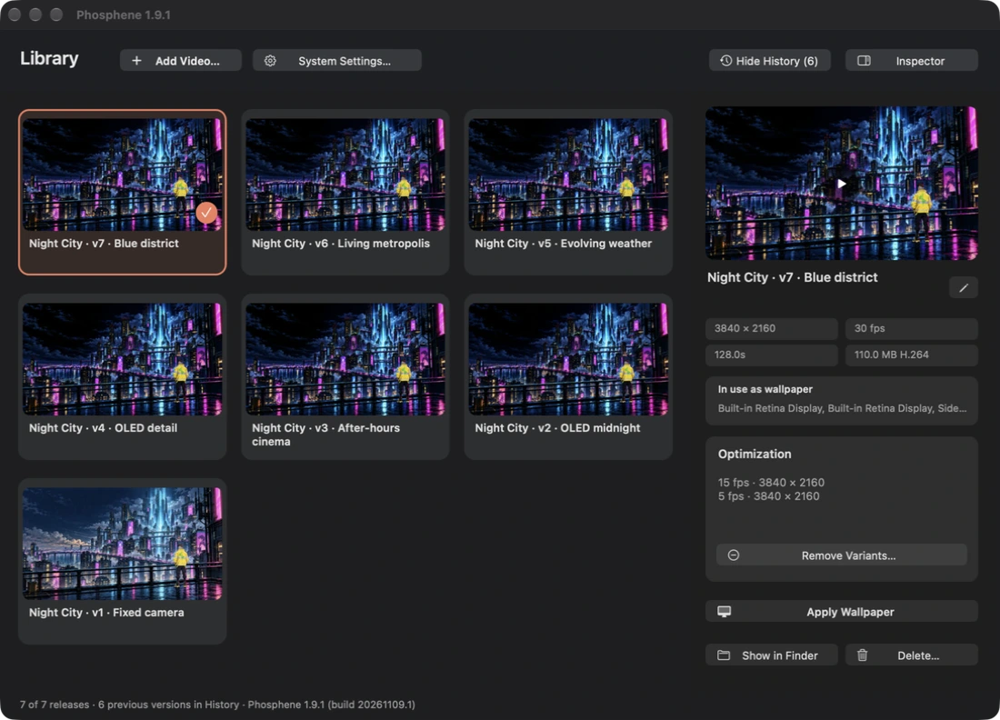
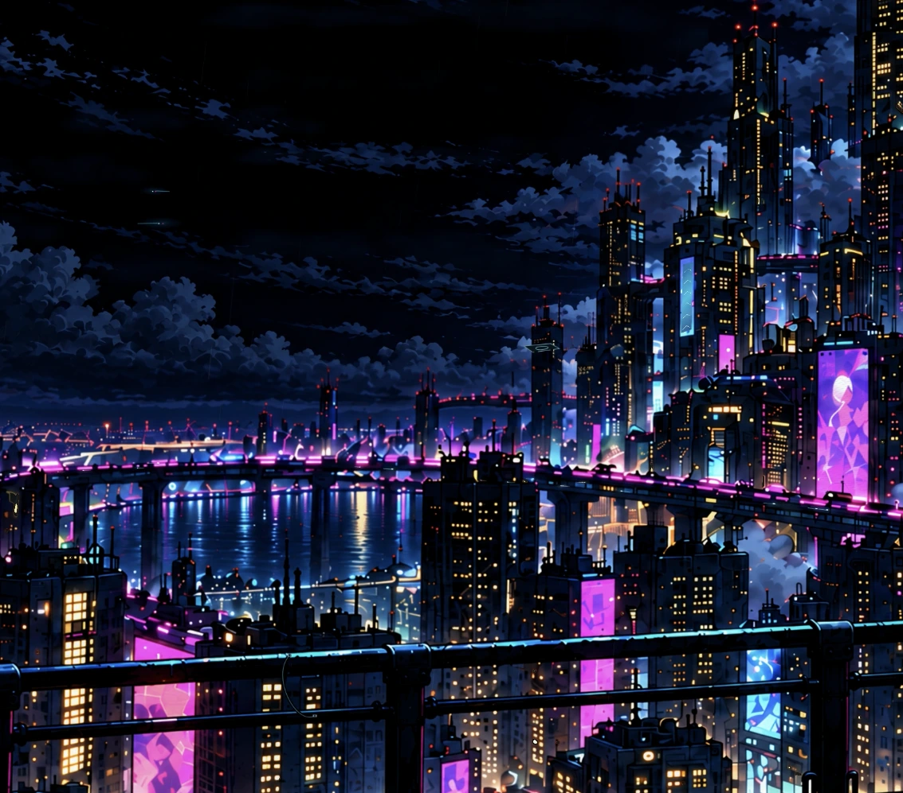

# Phosphene · Night City Edition

**A still camera. A living city. A native macOS desktop.**

[Explore the live showcase](https://korisame.github.io/phosphene-night-city/) · [Download the 4K wallpaper](https://github.com/korisame/phosphene-night-city/releases/tag/wallpaper-v7) · [Build the app](BUILDING.md) · [Credits](CREDITS.md)

[Watch the 24-second preview](https://korisame.github.io/phosphene-night-city/assets/night-city-preview.mp4)

An independent community edition of [Phosphene by kageroumado](https://github.com/kageroumado/phosphene), pairing a **Rust-built native interface** with a carefully animated **4K Night City fan-art wallpaper**. The original macOS wallpaper integration and product identity are credited and retained.

The city moves while the camera stays fixed: evolving weather, apartment lights, animated screens, small bridge traffic, glass lifts, rare aerial crossings, clothing details and wet reflections. The current release removes the earlier passing-train effect.

## Two versions, two purposes

| Component | Current release | Meaning |
| --- | --- | --- |
| Phosphene community app | **1.9.1 · build 20261109.1** | Native Rust/AppKit interface, stable release numbers, History and direct Apply Wallpaper |
| Night City wallpaper | **v7 · Blue district** | 3840 × 2160, 30 fps, silent 128-second loop |

The app's **History** reveals retained earlier wallpapers. Renaming a title preserves its release number. [Wallpaper catalogue](WALLPAPER-VERSIONS.md) documents all seven public cuts; old development-folder numbers are not release numbers.

## Get the wallpaper

- [4K / 30 fps master](https://github.com/korisame/phosphene-night-city/releases/download/wallpaper-v7/Night-City-v7-4K.mp4)
- [4K / 15 fps](https://github.com/korisame/phosphene-night-city/releases/download/wallpaper-v7/Night-City-v7-4K-15fps.mp4) and [4K / 5 fps](https://github.com/korisame/phosphene-night-city/releases/download/wallpaper-v7/Night-City-v7-4K-5fps.mp4)
- [4K still image](docs/assets/night-city-4k.webp)
- [All earlier versions](https://github.com/korisame/phosphene-night-city/releases)

Import the MP4 through **Add Video**. In this edition, choose **Apply Wallpaper** in Library. With the [original signed Phosphene app](https://kagerou.glass/phosphene/), select its collection in System Settings → Wallpaper. Do not add the MP4 as an ordinary still image.

The wallpaper files are also usable with other players supporting silent H.264 MP4. This repository's player is for **macOS 26+**, uses private Apple wallpaper frameworks and may need adaptation for later OS releases. Source builds require Apple tooling and signing coordination; this community edition does **not** distribute a signed/notarized app. [Build and installation notes](BUILDING.md).

## The actual app

Menu-bar panel and release History

These are app-window captures. Personal desktop files, accounts and notifications are excluded. The artwork images and preview clip come from the wallpaper itself; they are not screenshots of a private desktop.

## What is in the source

- [`native-rust/`](native-rust/) — AppKit controller UI, release catalog and native wallpaper application.
- [`rust-core/`](rust-core/) — independent playback policy, coverage, ramps, variant selection, cancellation and streaming BMP operations.
- [`Phosphene/`](Phosphene/), [`PhospheneExtension/`](PhospheneExtension/) — original Apple services and wallpaper-extension integration, with the local Rust bridge.
- [`wallpapers/night-city/`](wallpapers/night-city/) — portable procedural animation code and the illustration layers used for v7.
- [`docs/`](docs/) — static, responsive GitHub Pages showcase with local fonts, user-controlled video and reduced-motion support.

No always-running web server is required for the app or site. Large video masters are versioned as GitHub Release assets rather than Git blobs. [Architecture](ARCHITECTURE.md) · [Verification](VERIFICATION.md) · [Contributing](CONTRIBUTING.md).

## Credits and licenses

**kageroumado** created Phosphene, its icon and the original macOS wallpaper integration. **korisame** directs and curates the Night City edition, its animated wallpaper and native Rust interface.

The scene is fan artwork inspired by **Cyberpunk: Edgerunners**, a collaboration between **CD PROJEKT RED and Studio TRIGGER**. Night City, Cyberpunk 2077 and depicted characters belong to their respective owners. This project is unaffiliated and is not an official game/anime asset pack.

Software is [MIT-licensed](LICENSE), with third-party license notices retained. Artwork has [separate terms and provenance](ARTWORK.md); the software license grants no rights to third-party characters, trademarks or commercial use. [Full author and dependency credits](CREDITS.md).
